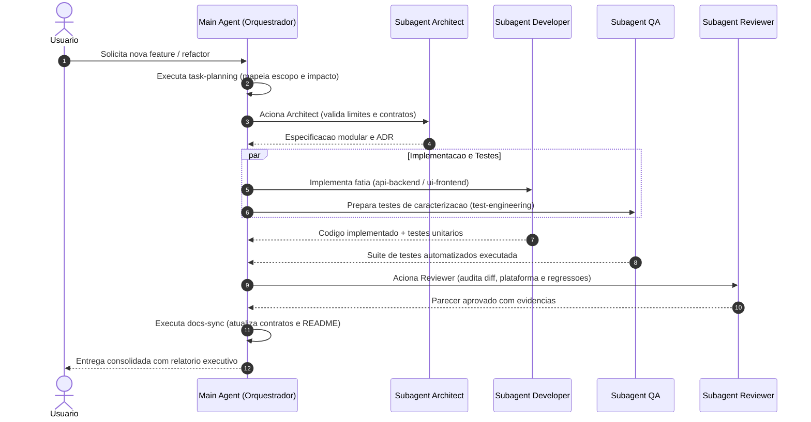

# Diretriz de Orquestracao Tecnica (Main Agent & Sub-agents Governance)

Este documento define o papel do **Main Agent (Orquestrador)** e a governanca da equipe de agentes e subagentes.

---

## Os Tres Niveis de Abstracao

```
┌────────────────────────────────────────────────────────┐
│               MAIN AGENT / ORQUESTRADOR                │
│       Entende a meta, planeja e coordena o fluxo        │
└───────────────────────────┬────────────────────────────┘
                            │
          ┌─────────────────┴─────────────────┐
          ▼                                   ▼
┌───────────────────────────┐       ┌───────────────────────────┐
│     SPECIALIZED AGENTS    │       │     REUSABLE SKILLS       │
│   (Quem e responsavel)    │       │      (Como executar)      │
│ - Architect               │       │ - architecture-invariants │
│ - Developer               │       │ - task-planning           │
│ - Reviewer                │       │ - api-backend             │
│ - QA                      │       │ - ui-frontend             │
│                           │       │ - test-engineering        │
│                           │       │ - platform-audit          │
│                           │       │ - regression-audit        │
│                           │       │ - ui-review               │
│                           │       │ - docs-sync               │
└───────────────────────────┘       └───────────────────────────┘
                            │
                            ▼
┌────────────────────────────────────────────────────────┐
│                 SUBAGENTS SOB DEMANDA                  │
│ Instancias efemeras e isoladas para tarefas paralelas   │
└────────────────────────────────────────────────────────┘
```

---

## Especialistas e Suas Atribuicoes

| Agente Especialista | Responsabilidade Primaria | Skills Chave |
| :--- | :--- | :--- |
| **Architect** | Design estrutural, limites modulares, ADRs e regra de 300 linhas. | `architecture-invariants`, `docs-sync` |
| **Developer** | Implementacao de fatias, refatores com baixo blast radius, i18n. | `api-backend`, `ui-frontend` |
| **Reviewer** | Auditoria de diffs, seguranca, portabilidade e design tokens. | `regression-audit`, `platform-audit`, `ui-review` |
| **QA** | Testes de caracterizacao, automacao unitaria e E2E deterministico. | `test-engineering` |

---

## Regras de Ouro de Governanca e Concorrencia

1. **Politica Estrita de Tokens (Zero Emojis - ADR-001):**
   - Emojis sao terminantemente proibidos em respostas, logs, commits e documentacao.
   - Use marcadores textuais formais: `[OK]`, `[FALHA]`, `[AVISO]`, `[INFO]`, `[CRITICO]`.

2. **Quando disparar Subagentes:**
   - Para tarefas atomicas e de investigacao que geram muitos logs ou tokens (ex.: rodar suite de testes, inspecionar historico git, analisar contratos).
   - O subagente conclui o trabalho e retorna **apenas um resumo executivo com evidencias**, mantendo a janela de contexto principal despoluida.

3. **Paralelismo de Leitura e Analise (2 a 4 simultaneos):**
   - Permitido e encorajado. Exemplo: Enquanto o `Developer` implementa a fatia em um subagente, o `QA` prepara cenarios de teste em outro e o `Reviewer` faz auditoria de seguranca da modelagem.

4. **Escrita Concorrente E Proibida:**
   - **Nunca** permita que dois subagentes editem os mesmos arquivos ao mesmo tempo. A escrita de codigo deve ser coordenada em passos sequenciais ou isolada por diretorios completamente independentes.

5. **Exigencia de Evidencias (Harness First):**
   - Nenhuma entrega e dada por concluida sem validacao automatizada. O subagente deve executar a suite correspondente e anexar o relatorio de aprovacao no fechamento.

---

## Ciclo de Vida Padrao de uma Demanda


